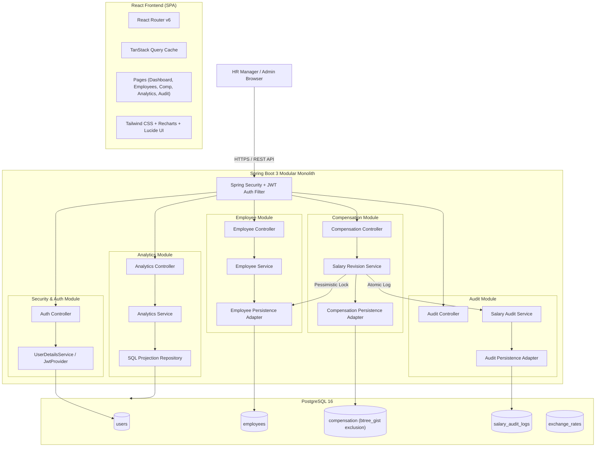
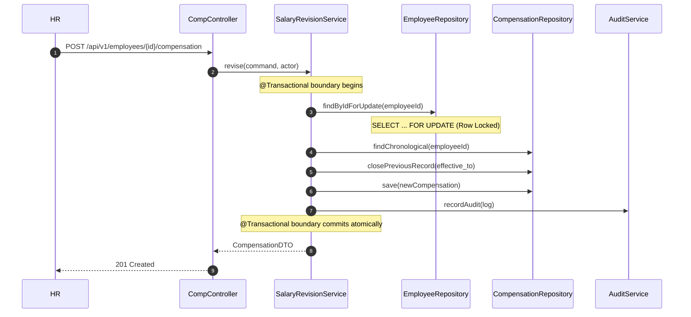

# ACME CompensationOS: High-Level Architecture & System Design

**System:** ACME CompensationOS  
**Architecture Style:** Microservice-Ready Modular Monolith  
**Runtime:** Spring Boot 3.3.x (Java 21+) & React 18 (Vite + TypeScript)  
**Database:** PostgreSQL 16 (Relational & Temporal)

---

## 1. High-Level Architecture (HLD)



---

## 2. Module Responsibilities & Public Contracts

| Module | Core Responsibility | Public Interface / Contract | Internal Persistence |
|---|---|---|---|
| **`security`** | User authentication, JWT issuance, password hashing | `SecurityContextHolder`, `UserDetailsService` | `users` table |
| **`employee`** | Employee directory, lifecycle status, CRUD | `EmployeeReaderPort` (`findById`, `existsById`) | `employees` table |
| **`compensation`** | Effective-dated salary management, revisions | `ReviseCompensationUseCase`, `CompensationQueryPort` | `compensation` table |
| **`audit`** | Immutable salary revision compliance logging | `SalaryAuditWriterPort` | `salary_audit_logs` table |
| **`analytics`** | Database-optimized statistical calculations | `AnalyticsQueryPort` | Direct read projections |

### Inter-Module Communication Rule
- Modules communicate exclusively via Java Interfaces (Ports) and DTOs.
- `Compensation` never references `EmployeeEntity` or imports JPA repositories from `employee`.
- Modules share zero mutable entities.

---

## 3. Database-Level Temporal & Concurrency Architecture

### 3.1 Overlap Prevention with `btree_gist`
PostgreSQL prevents overlapping date slices for any employee via an exclusion constraint:
```sql
ALTER TABLE compensation ADD CONSTRAINT chk_comp_no_overlapping_periods
EXCLUDE USING gist (
    employee_id WITH =,
    daterange(effective_from, COALESCE(effective_to, 'infinity'::date), '[]') WITH &&
);
```

### 3.2 Pessimistic Write Lock Sequence


---

## 4. Multi-Currency Strategy
1. **Zero Currency Mixed Aggregation**: Direct summation or averaging across disparate currencies is prohibited in application code and SQL.
2. **Explicit Grouping**: All aggregate queries group by `currency` and `department`/`country`.
3. **Consolidated Valuation (Optional)**: If a unified reporting currency is selected, rates are pulled from the `exchange_rates` table on the valuation date.
