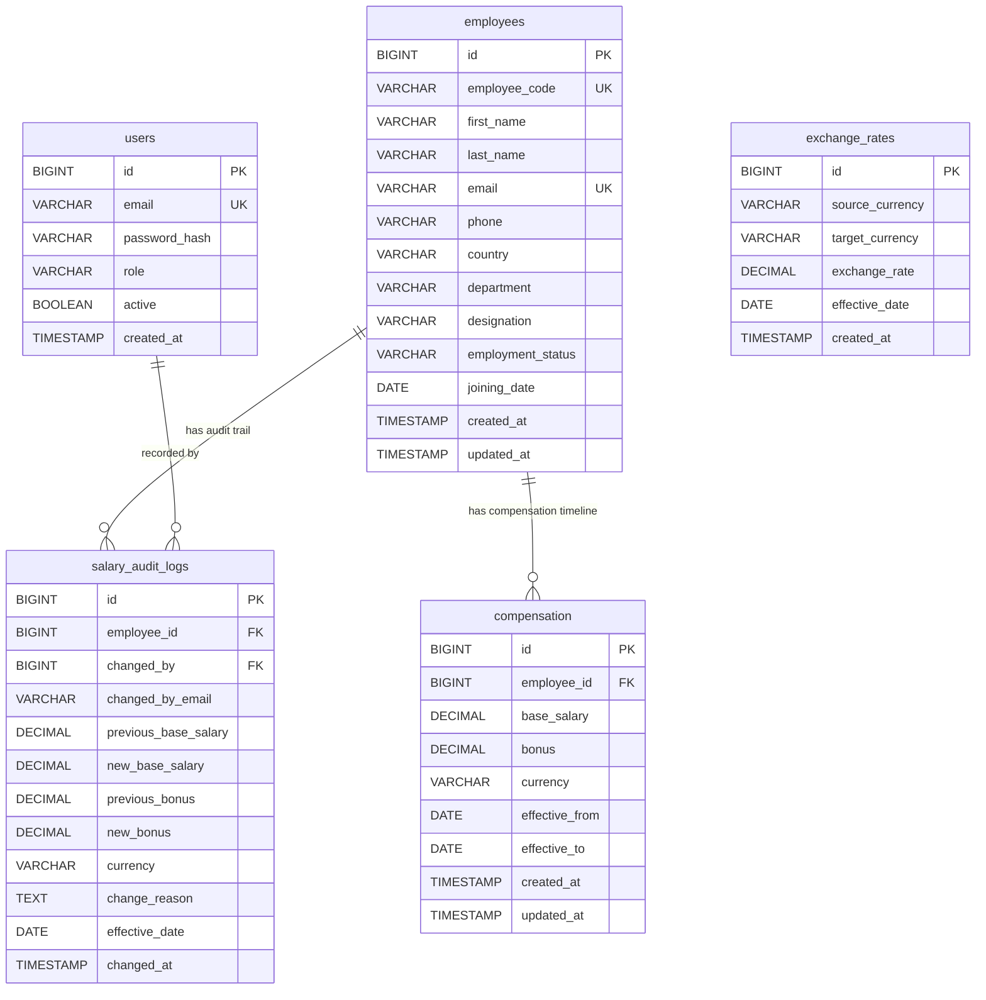

# ACME CompensationOS: Database Design & Schema Specifications

**Database Engine:** PostgreSQL 16  
**Migration Tool:** Flyway 10.x  
**Precision Standard:** ISO-4217 Currencies, `DECIMAL(19,4)` for monetary values, `btree_gist` exclusion constraints

---

## 1. Entity-Relationship (ER) Diagram



---

## 2. Table Specifications & Constraints

### 2.1 Table: `users`
- Stores administrative and HR manager user accounts for JWT authentication.
- **Columns**:
  - `id`: `BIGSERIAL PRIMARY KEY`
  - `email`: `VARCHAR(120) NOT NULL UNIQUE`
  - `password_hash`: `VARCHAR(255) NOT NULL` (BCrypt encoded)
  - `role`: `VARCHAR(50) NOT NULL` (`ROLE_ADMIN`, `ROLE_HR_MANAGER`)
  - `active`: `BOOLEAN NOT NULL DEFAULT TRUE`
  - `created_at`: `TIMESTAMP WITH TIME ZONE DEFAULT CURRENT_TIMESTAMP`

### 2.2 Table: `employees`
- Stores core personnel records.
- **Columns**:
  - `id`: `BIGSERIAL PRIMARY KEY`
  - `employee_code`: `VARCHAR(30) NOT NULL UNIQUE`
  - `first_name`: `VARCHAR(100) NOT NULL`
  - `last_name`: `VARCHAR(100) NOT NULL`
  - `email`: `VARCHAR(150) NOT NULL UNIQUE`
  - `phone`: `VARCHAR(50)`
  - `country`: `VARCHAR(60) NOT NULL` (India, USA, UK, Germany, UAE)
  - `department`: `VARCHAR(80) NOT NULL` (Engineering, Product, Sales, etc.)
  - `designation`: `VARCHAR(100) NOT NULL`
  - `employment_status`: `VARCHAR(30) NOT NULL` (`ACTIVE`, `ON_LEAVE`, `TERMINATED`)
  - `joining_date`: `DATE NOT NULL`
  - `created_at`: `TIMESTAMP WITH TIME ZONE DEFAULT CURRENT_TIMESTAMP`
  - `updated_at`: `TIMESTAMP WITH TIME ZONE DEFAULT CURRENT_TIMESTAMP`
- **Indexes**:
  - `idx_employees_code`: B-Tree on `employee_code`
  - `idx_employees_email`: B-Tree on `email`
  - `idx_employees_filter`: Composite B-Tree on `(country, department, employment_status)`

### 2.3 Table: `compensation`
- Effective-dated compensation records.
- **Columns**:
  - `id`: `BIGSERIAL PRIMARY KEY`
  - `employee_id`: `BIGINT NOT NULL REFERENCES employees(id) ON DELETE RESTRICT`
  - `base_salary`: `DECIMAL(19,4) NOT NULL CHECK (base_salary > 0)`
  - `bonus`: `DECIMAL(19,4) NOT NULL DEFAULT 0.0000 CHECK (bonus >= 0)`
  - `currency`: `VARCHAR(3) NOT NULL` (`INR`, `USD`, `GBP`, `EUR`, `AED`)
  - `effective_from`: `DATE NOT NULL`
  - `effective_to`: `DATE` (NULL indicates ongoing/open-ended)
  - `created_at`: `TIMESTAMP WITH TIME ZONE DEFAULT CURRENT_TIMESTAMP`
  - `updated_at`: `TIMESTAMP WITH TIME ZONE DEFAULT CURRENT_TIMESTAMP`
- **Exclusion Constraint**:
  ```sql
  CONSTRAINT chk_comp_no_overlapping_periods EXCLUDE USING gist (
      employee_id WITH =,
      daterange(effective_from, COALESCE(effective_to, 'infinity'::date), '[]') WITH &&
  );
  ```
- **Chronological Check Constraint**:
  ```sql
  CONSTRAINT chk_comp_dates_order CHECK (effective_to IS NULL OR effective_to >= effective_from);
  ```
- **Indexes**:
  - `idx_comp_lookup`: Composite B-Tree on `(employee_id, effective_from, effective_to)`
  - `idx_comp_currency_active`: Composite B-Tree on `(currency, effective_from, effective_to)`

### 2.4 Table: `salary_audit_logs`
- Immutable revision logs.
- **Columns**:
  - `id`: `BIGSERIAL PRIMARY KEY`
  - `employee_id`: `BIGINT NOT NULL REFERENCES employees(id) ON DELETE RESTRICT`
  - `changed_by`: `BIGINT REFERENCES users(id)`
  - `changed_by_email`: `VARCHAR(150) NOT NULL`
  - `previous_base_salary`: `DECIMAL(19,4) NOT NULL`
  - `new_base_salary`: `DECIMAL(19,4) NOT NULL`
  - `previous_bonus`: `DECIMAL(19,4) NOT NULL`
  - `new_bonus`: `DECIMAL(19,4) NOT NULL`
  - `currency`: `VARCHAR(3) NOT NULL`
  - `change_reason`: `TEXT NOT NULL`
  - `effective_date`: `DATE NOT NULL`
  - `changed_at`: `TIMESTAMP WITH TIME ZONE DEFAULT CURRENT_TIMESTAMP`
- **Indexes**:
  - `idx_audit_employee_time`: Composite B-Tree on `(employee_id, changed_at DESC)`
  - `idx_audit_changed_at`: B-Tree on `changed_at DESC`

### 2.5 Table: `exchange_rates`
- Seeded conversion table for optional consolidated valuation.
- **Columns**:
  - `id`: `BIGSERIAL PRIMARY KEY`
  - `source_currency`: `VARCHAR(3) NOT NULL`
  - `target_currency`: `VARCHAR(3) NOT NULL`
  - `exchange_rate`: `DECIMAL(19,6) NOT NULL`
  - `effective_date`: `DATE NOT NULL`
  - `created_at`: `TIMESTAMP WITH TIME ZONE DEFAULT CURRENT_TIMESTAMP`
